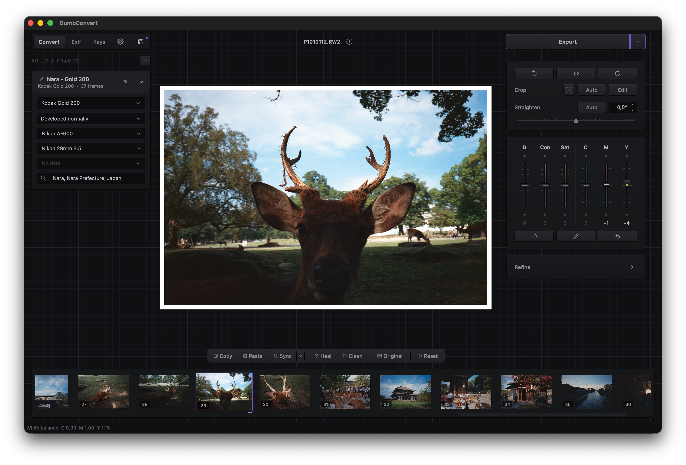

<h1 align="center">DumbConvert</h1>

<p align="center">
  Film negatives in, pictures out.<br>
  A quick converter for camera scans, before you catalogue them in your favourite program.
</p>

<p align="center">
  <a href="https://github.com/jiijii0/dumbconvert/releases/latest"></a>
  
  
  
  <a href="https://github.com/marcinz606/NegPy"></a>
  <a href="LICENSE"></a>
</p>

<p align="center">
  <a href="https://github.com/jiijii0/dumbconvert/releases/tag/v0.1.0-beta.2"><b>macOS beta</b></a>
  &nbsp;·&nbsp;
  <a href="https://github.com/jiijii0/dumbconvert/releases/tag/windows-linux-alpha.1"><b>Windows alpha</b></a>
  &nbsp;·&nbsp;
  <a href="https://github.com/jiijii0/dumbconvert/releases/tag/windows-linux-alpha.1"><b>Linux alpha</b></a>
  <br>
  <sub>The Windows and Linux alphas have not been tested yet.</sub>
</p>



## Why it's nice

- **Drop and go.** Drop a roll, pick its film, get good colour straight away.
- **Film-true colour.** Each stock gets the colours it takes on photo paper, worked out from its data sheet.
- **Decluttered.** Six faders, like a lab scanner. The rest stays folded away.
- **No library.** No projects, no catalogue, no sidecar files. Open, convert, close.
- **Rolls match.** A roll is measured as one, so its frames share the same colour.
- **Keyboard first.** Everything has a key, and every key can be changed.
- **Film data in the file.** Stock, camera, lens, date and place go into the EXIF.
- **Any format.** JPEG, HEIC, TIFF, PNG, AVIF, JPEG XL, WebP, or DNG for your raw editor.
- **Dust, your way.** Click a speck, or draw around an area and let it find the dust and scratches.
- **Contact sheets.** A whole roll on one sheet, film edges included.
- **Private.** Your scans are never changed and never uploaded.

Made for negatives scanned with a digital camera over a white light, colour or B&W.

## Install

1. Download the zip from the [macOS beta](https://github.com/jiijii0/dumbconvert/releases/tag/v0.1.0-beta.2) and unzip it.
2. Move **DumbConvert** to Applications.

Windows and Linux (Flatpak): see the [alpha release](https://github.com/jiijii0/dumbconvert/releases/tag/windows-linux-alpha.1)
for the files and how to install them. These builds have not been tested yet.

### First launch

The beta is not signed by Apple, so macOS blocks it once.

1. Open DumbConvert. macOS says it cannot be opened. Click **Done**.
2. Go to **System Settings › Privacy & Security**, scroll down, click **Open Anyway**.
3. Click **Open Anyway** again and confirm.

On macOS 14 or older: right-click the app, choose **Open**, then **Open**.

Still blocked? Run this once in Terminal:

```sh
xattr -dr com.apple.quarantine /Applications/DumbConvert.app
```

## Run from source

Needs Python 3.13+ and Rust (`brew install rust`).

```sh
git clone https://github.com/jiijii0/dumbconvert.git
cd dumbconvert
python3 -m venv .venv
.venv/bin/pip install -r requirements.txt
.venv/bin/pip install ./vendor/negpy/negpy_core
.venv/bin/pip install --no-deps -e ./vendor/negpy
./run.command
```

`./packaging/build.sh` builds the app and its zip into `dist/`.

Want to help? See [CONTRIBUTING.md](CONTRIBUTING.md): how to run the tests, and what makes a pull
request easy to merge.

## More

Every key, how it works and why the defaults are what they are: [docs/details.md](docs/details.md).

The place search sends the text you type to [Photon](https://photon.komoot.io), a free
OpenStreetMap search. Nothing else leaves your computer.

## Thanks

To [NegPy](https://github.com/marcinz606/NegPy), by marcinz606 and its contributors. The conversion
engine is theirs; I built on it and tuned it for this app.

GPLv3, like NegPy. See [LICENSE](LICENSE).

## Support

If DumbConvert saves you some time, you can buy me a coffee.

[](https://ko-fi.com/jiijii0)
